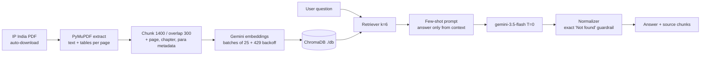

# Project 2 — Designs Law Assistant

A zero-hallucination RAG app over the 87-page CGPDTM **Manual of Designs Practice & Procedure** (IP India).
It answers only from retrieved chunks, cites `Chapter / Para / Page`, and returns exactly `Not found` when the manual does not contain the answer.

**Stack:** Python · LangChain (LCEL) · ChromaDB (`./db`) · Gemini (`gemini-embedding-001`, `gemini-3.5-flash`, temperature 0) · Streamlit · PyMuPDF (tables kept aligned)

## RAG flow



## Setup

```bash
cd designs-law-assistant
python3 -m venv .venv && source .venv/bin/activate      # Windows: .venv\Scripts\activate
pip install -r requirements.txt
cp .env.example .env                                     # then put your GEMINI_API_KEY in .env
python ingest.py                                         # downloads the PDF into data/ and builds ./db
python ask.py --eval                                     # runs the 5 LMS questions, writes eval_results.md, fills the table below
streamlit run app.py                                     # UI with one-click evaluation buttons
```

If every download URL fails (network/SSL), save the manual manually as `data/manual_of_designs.pdf` and re-run `python ingest.py`.

`config.py` auto-detects the key type: `AQ.`-prefixed keys are tried on the Gemini Developer API first (`vertexai=False`) and automatically switch to Vertex AI Express Mode (`vertexai=True`). Force one with `GENAI_BACKEND=aistudio` or `GENAI_BACKEND=vertex`.

## Results (5 LMS questions)

<!-- EVAL_TABLE_START -->
| # | Question | Answer | Retrieved pages |
|---|---|---|---|
| 1 | How long does a proprietor have copyright in a registered design, and can it be extended? | A proprietor has copyright in a registered design for ten years from the date of registration. This period can be extended by five years if the registered proprietor applies for extension in the prescribed manner before the expiration of the original ten-year period (Reference: Chapter 6, Section 11, Page 36; Chapter 7, Section 11(2), Form 3, Page 39). | p.35; p.36; p.39; p.40; p.63 |
| 2 | Which classification system is used to register designs? | Designs are classified under the Third Schedule of the Design Rules, 2001 (which contains thirty-one classes and a miscellaneous class 99) based on the Locarno Classification system / International Classification of Industrial Designs (Reference: Chapter 1 – Introduction, Page 5; Chapter 3 – Filing of Design Application, Form-1, Third Schedule, Page 14, 20). | p.5; p.14; p.20; p.27; p.33 |
| 3 | What is the government fee to register a trademark? | Not found | p.7; p.22; p.23; p.38; p.44; p.51 |
| 4 | Who is the current Controller General of Patents? | Not found | p.1; p.4; p.7; p.51 |
| 5 | What is the fee to register a design? | The fee to be paid in respect of any matter is prescribed in the First Schedule of The Design Rules, 2001 (Reference: Chapter 3 – Filing of Design Application, Para 0308, Page 22). | p.11; p.22; p.23; p.24; p.33; p.48 |
<!-- EVAL_TABLE_END -->

Expected behaviour: Q3 (trade mark fee) and Q4 (current officeholder vs. the static 2011 manual) must return exactly `Not found`.

## Screenshots

Save Streamlit screenshots in `images/` and link them here, e.g. ``.

## Files

| File | Purpose |
|---|---|
| `config.py` | API key, backend auto-detection, model and chunking constants, 429 backoff helper |
| `ingest.py` | PDF download + extraction + chunking + metadata + batched embedding into `./db` |
| `rag_chain.py` | Retriever, few-shot LCEL prompt, `Not found` normalizer |
| `ask.py` | Interactive CLI and `--eval` mode |
| `app.py` | Streamlit UI with source panel |
